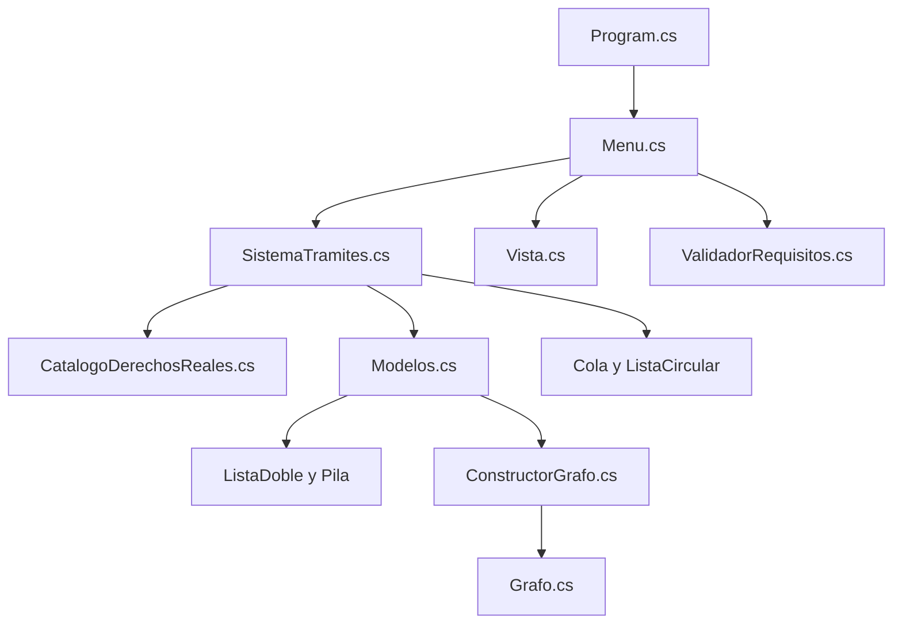
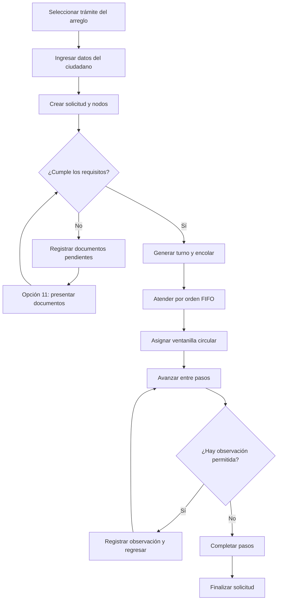
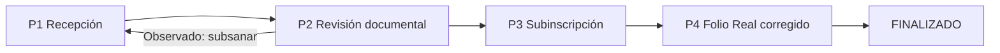
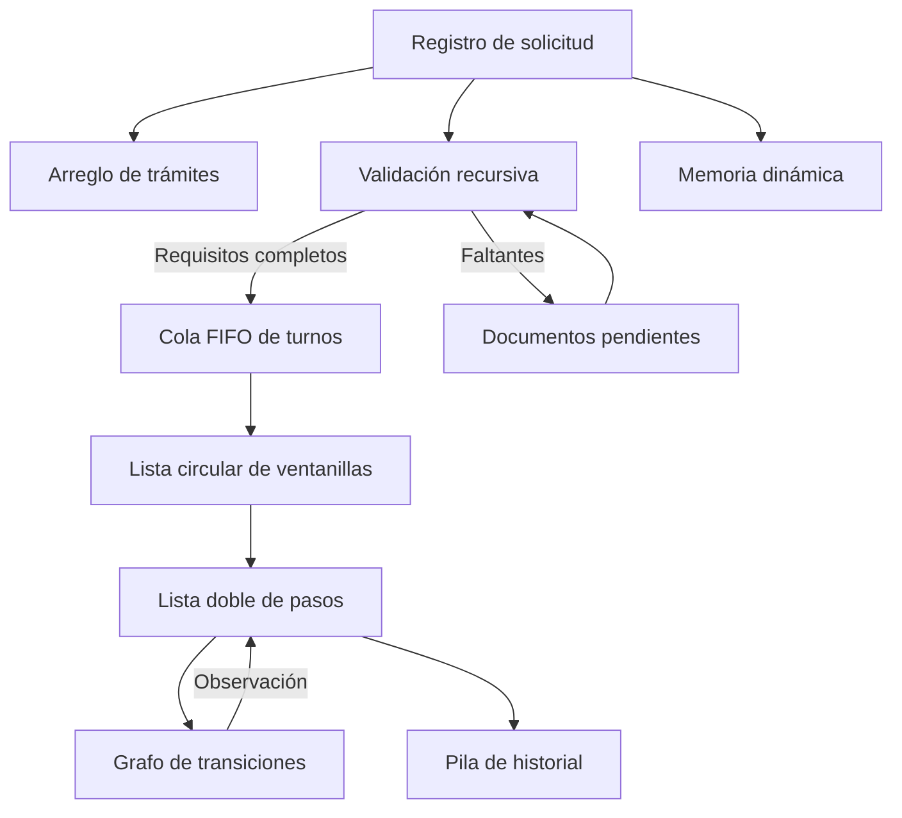

<div align="center">

# 🏛️ TRAMITEAGIL DDRR
### Sistema de Gestión de Trámites y Turnos — Derechos Reales, La Paz

**PROYECTO FINAL INTEGRADOR · ESTRUCTURA DE DATOS**

**Aplicación de consola en C# · .NET 8**

> Documentación académica del desarrollo, las estructuras de datos y los algoritmos aplicados.

|:---|:---|
| Universidad | Universidad Privada Domingo Savio — Sede La Paz |
| Carrera | **INGENIERIA EN SISTEMAS** |
| Asignatura | Estructura de Datos |
| Semestre | 5.º semestre |
| Docente | Msc. Lic. Andrés Grover Albino Chambi |
| Estudiante | **Asaf Luis Carlos Roldan Machicado** |
| Gestión y fecha de entrega | **28 de octubre de 2026** |
| Repositorio | **https://github.com/asafnerdrm-coder/Proyecto_Final_Integrador_4.git** |

</div>

---

## 📚 Índice

1. [Presentación y propósito](#1-presentación-y-propósito)
2. [Problema y contexto de Derechos Reales](#2-problema-y-contexto-de-derechos-reales)
3. [Objetivos y resultados de aprendizaje](#3-objetivos-y-resultados-de-aprendizaje)
4. [Tecnologías y organización del código](#4-tecnologías-y-organización-del-código)
5. [Funcionamiento general del programa](#5-funcionamiento-general-del-programa)
6. [CV1 — Arreglos y memoria dinámica](#6-cv1--arreglos-y-memoria-dinámica)
7. [CV1 — Recursividad y árboles de requisitos](#7-cv1--recursividad-y-árboles-de-requisitos)
8. [CV1 — Pila: historial LIFO](#8-cv1--pila-historial-lifo)
9. [CV1 — Cola: atención FIFO](#9-cv1--cola-atención-fifo)
10. [CV2 — Lista doblemente enlazada](#10-cv2--lista-doblemente-enlazada)
11. [CV2 — Lista circular de ventanillas](#11-cv2--lista-circular-de-ventanillas)
12. [CV3 — Grafo dirigido y algoritmos](#12-cv3--grafo-dirigido-y-algoritmos)
13. [Integración entre las estructuras](#13-integración-entre-las-estructuras)
14. [Trámites que modela el sistema](#14-trámites-que-modela-el-sistema)
15. [Ejemplo completo de ejecución](#15-ejemplo-completo-de-ejecución)
16. [Complejidad computacional](#16-complejidad-computacional)
17. [Pruebas y evidencias](#17-pruebas-y-evidencias)
18. [Instalación y ejecución desde CMD](#18-instalación-y-ejecución-desde-cmd)
19. [Aporte a la asignatura y defensa oral](#19-aporte-a-la-asignatura-y-defensa-oral)
20. [Alcance, limitaciones y mejoras futuras](#20-alcance-limitaciones-y-mejoras-futuras)
21. [Conclusiones](#21-conclusiones)
22. [Referencias y créditos](#22-referencias-y-créditos)

---

## 1. Presentación y propósito

**TramiteAgil DDRR** es un proyecto académico ejecutable en la consola de Windows, desarrollado en **C# y .NET 8**, que simula la gestión de trámites vinculados con Derechos Reales de La Paz, Bolivia. Permite consultar un catálogo, registrar ciudadanos y solicitudes, verificar documentos, emitir turnos, atender en ventanillas y visualizar el avance del trámite.

Su finalidad principal en la materia no es sustituir un sistema institucional existente, sino **demostrar la aplicación práctica de las estructuras de datos**: cómo se representan en memoria, cómo se conectan sus nodos, cómo se recorren, qué operaciones ofrecen y por qué se escoge cada una.

**Alcance académico:** Los requisitos, trámites, pasos y tiempos contenidos en el programa son modelos didácticos. No constituyen un catálogo oficial actualizado ni garantizan plazos de atención. Derechos Reales pertenece al ámbito registral del Órgano Judicial; no es una unidad de la Alcaldía. Las gestiones notariales o municipales incluidas en el modelo de transferencia se identifican como **etapas externas**.

### Relación con los criterios de evaluación

| Criterio del proyecto | Peso indicado por el docente | Contenidos aplicados | Evidencia de código |
|---|---:|---|---|
| **CV1** | **25 %** | Arreglos, memoria dinámica, recursividad, pila y cola | `SistemaTramites`, `ValidadorRequisitos`, `Pila`, `Cola`, `Nodo` |
| **CV2** | **35 %** | Lista doblemente enlazada y lista circular | `ListaDoble`, `ListaCircular`, `Solicitud` |
| **CV3** | **40 %** | Grafo dirigido, lista de adyacencia, BFS, DFS y ciclos | `Grafo`, `ConstructorGrafo`, `Vista` |

> **Idea de defensa:** “Cada estructura se eligió por un comportamiento concreto: cola para orden de llegada; pila para último cambio; lista doble para avanzar o retroceder; lista circular para rotación; grafo para representar decisiones y caminos”.

---

## 2. Problema y contexto de Derechos Reales

Los procedimientos registrales relativos a inmuebles pueden involucrar requisitos documentales, verificaciones y varias etapas de revisión. Para una persona que realiza un trámite es importante saber **qué documentos debe presentar, qué etapa le corresponde y qué ocurre si la solicitud recibe una observación**.

El proyecto representa tres necesidades administrativas:

1. **Organizar la recepción:** asignar turnos por orden de llegada y distribuir la atención entre ventanillas.
2. **Controlar requisitos y pasos:** identificar documentos faltantes y modelar etapas vinculadas entre sí.
3. **Permitir el seguimiento:** conocer el estado actual, conservar el historial y mostrar posibles devoluciones.

La aplicación modela estos procedimientos de forma educativa. No mide demoras reales, no reduce por sí sola los tiempos de una oficina y no está conectada con bases de datos ni servicios oficiales. Su propuesta tecnológica es mostrar cómo podrían **estructurarse los datos y decisiones** de un flujo administrativo.

---

## 3. Objetivos y resultados de aprendizaje

### Objetivo general

Desarrollar una aplicación de consola en C# que simule la gestión de trámites registrales y permita **aplicar y defender** las estructuras de datos estudiadas durante la asignatura.

### Objetivos específicos

- Construir un **arreglo** con tipos de trámite, requisitos y pasos.
- Crear **objetos y nodos dinámicamente** durante el funcionamiento de la aplicación.
- Verificar **requisitos simples y compuestos mediante recursividad**.
- Administrar el historial mediante una **pila LIFO** implementada con nodos.
- Gestionar turnos por una **cola FIFO** implementada con nodos.
- Recorrer etapas utilizando una **lista doblemente enlazada**.
- Distribuir ventanillas mediante una **lista circular**.
- Representar relaciones y devoluciones mediante un **grafo dirigido**, recorridos BFS, DFS y detección de ciclos.
- Comprobar estructuras y comportamientos mediante pruebas automatizadas y manuales.

### Qué se aprende al construirlo

El proyecto permite contrastar estructuras lineales y no lineales, distinguir el orden FIFO/LIFO, trabajar con referencias, comprender los casos base recursivos, aplicar algoritmos de recorrido y analizar el costo de las operaciones.

---

## 4. Tecnologías y organización del código

| Tecnología | Uso |
|---|---|
| **C#** | Clases, objetos, genéricos (`<T>`), condicionales, ciclos y algoritmos |
| **.NET 8** | Compilación y ejecución de la aplicación |
| **Consola / CMD** | Interacción por teclado y presentación de resultados en texto |
| **Visual Studio o VS Code** | Escritura y revisión del código |
| **Git y GitHub** | Control de versiones y publicación del README y código fuente |

### Estructura real de carpetas

```text
TramiteAgil/
├── TramiteAgil.csproj
├── README.md
├── Estructuras/
│   ├── Nodo.cs
│   ├── Pila.cs
│   ├── Cola.cs
│   ├── ListaDoble.cs
│   ├── ListaCircular.cs
│   └── Grafo.cs
├── Modelos/
│   └── Modelos.cs
├── Servicios/
│   ├── CatalogoDerechosReales.cs
│   ├── ValidadorRequisitos.cs
│   ├── ConstructorGrafo.cs
│   └── SistemaTramites.cs
├── Interfaz/
│   ├── Program.cs
│   ├── Menu.cs
│   ├── Vista.cs
│   ├── Demo.cs
│   └── Pruebas.cs
└── docs/
    ├── INFORME_TECNICO.md
    └── GUION_VIDEO.md
```

> Este README reemplaza o complementa el README del repositorio; los demás archivos se muestran según el proyecto `TramiteAgil_DDRR_Mejorado.zip` analizado. El código ejecutable se encuentra en `TramiteAgil.csproj` y las clases C# que aparecen en las carpetas anteriores.

### Mapa directo: ¿dónde está cada tema de la asignatura?

| Tema estudiado | Archivo para abrir en GitHub | Método o clase que debes señalar |
|---|---|---|
| Arreglos | [`CatalogoDerechosReales.cs`](Servicios/CatalogoDerechosReales.cs) | `Crear()` y `TipoTramite[]` |
| Memoria dinámica | [`Nodo.cs`](Estructuras/Nodo.cs) | `Nodo<T>` y llamadas a `new` |
| Recursividad / requisitos jerárquicos | [`ValidadorRequisitos.cs`](Servicios/ValidadorRequisitos.cs) | `Validar`, `ValidarLista`, `Arbol` |
| Pila | [`Pila.cs`](Estructuras/Pila.cs) | `Push`, `Pop`, `Peek` |
| Cola | [`Cola.cs`](Estructuras/Cola.cs) | `Encolar`, `Desencolar`, `Frente` |
| Lista doble | [`ListaDoble.cs`](Estructuras/ListaDoble.cs) | `MoverSiguiente`, `MoverAnterior` |
| Lista circular | [`ListaCircular.cs`](Estructuras/ListaCircular.cs) | `Rotar`, `UnaVuelta` |
| Grafo, BFS, DFS, ciclos | [`Grafo.cs`](Estructuras/Grafo.cs) | `RutaMasCorta`, `RecorridoDFS`, `TieneCiclos` |
| Flujo de una solicitud | [`Modelos.cs`](Modelos/Modelos.cs) | `Solicitud.Avanzar`, `Retroceder`, `Deshacer` |
| Turnos y ventanillas | [`SistemaTramites.cs`](Servicios/SistemaTramites.cs) | `GenerarTurno`, `AtenderSiguiente` |
| Menú de consola | [`Menu.cs`](Interfaz/Menu.cs) | `Ejecutar` y opciones `1` a `11` |
| Pruebas automáticas | [`Pruebas.cs`](Interfaz/Pruebas.cs) | `Ejecutar()` |

> Los enlaces son **relativos al archivo `README.md`**, por lo que funcionarán al colocar este documento dentro de la carpeta del proyecto que contiene `Estructuras/`, `Modelos/`, `Servicios/` e `Interfaz/`.

### Responsabilidad de cada carpeta

**`Estructuras/`** contiene las implementaciones de nodos, pila, cola, listas y grafo. No son simples explicaciones: estas clases se utilizan en el funcionamiento del sistema.

**`Modelos/`** define los conceptos del dominio: `Ciudadano`, `TipoTramite`, `Requisito`, `Paso`, `Solicitud`, `Turno`, `Ventanilla`, `EntradaHistorial` y los estados de una solicitud.

**`Servicios/`** coordina el catálogo, las solicitudes y turnos, la validación recursiva y la construcción de grafos.

**`Interfaz/`** permite ingresar datos desde el teclado, mostrar resultados y ejecutar pruebas y demostraciones desde CMD.

### Diagrama general de responsabilidades



---

## 5. Funcionamiento general del programa

Al iniciarse, `Program.Main` establece la codificación de consola, crea un objeto `SistemaTramites` y abre `Menu.Ejecutar()`. Existen además dos modos especiales: `--test` y `--demo`.

### Opciones reales del menú

| Opción | Operación | Concepto principalmente demostrado |
|---:|---|---|
| **1** | Ver catálogo de trámites | Arreglos y requisitos jerárquicos |
| **2** | Nueva solicitud, validar documentos y generar turno si corresponde | Objetos, recursividad y cola |
| **3** | Atender siguiente turno | Cola FIFO y lista circular |
| **4** | Avanzar un paso | Lista doblemente enlazada |
| **5** | Observar trámite / retroceder | Grafo de devoluciones y lista doble |
| **6** | Consultar seguimiento | Estado y recorrido de pasos |
| **7** | Ver historial y opción de deshacer | Pila LIFO |
| **8** | Mostrar grafo del trámite | Grafo, BFS, DFS y ciclos |
| **9** | Ver cola y ventanillas | Cola y rotación circular |
| **10** | Ejecutar demostración automática | Integración de estructuras |
| **11** | Presentar documentos pendientes / subsanar | Recursividad y gestión de requisitos |
| **0** | Salir | Finaliza el programa |

### Flujo de una solicitud



> El diagrama resume el flujo conceptual. En esta versión, la observación **por requisitos faltantes** se resuelve con la opción 11; las observaciones de **revisión de pasos** se registran por la opción 5 y siguen una lógica distinta. No deben confundirse ambos casos.

---

## 6. CV1 — Arreglos y memoria dinámica

### 6.1 Arreglos: guardar tipos de trámite

**Definición:** un arreglo reúne elementos de un mismo tipo y permite acceder a ellos mediante un índice.

**Dónde se implementó:**

- `Servicios/CatalogoDerechosReales.cs`, método `Crear()`.
- `Servicios/SistemaTramites.cs`, propiedad `TipoTramite[] Catalogo`.
- `Modelos/Modelos.cs`, propiedades `Requisito[] Requisitos`, `Paso[] Pasos` y `int[] VuelveA`.

Fragmento representativo del catálogo real:

```csharp
return new TipoTramite[] { certificado, correccion, transferencia };
```

El catálogo contiene **tres elementos** (`CNP`, `COR`, `TRA`). Cada tipo almacena arreglos de requisitos y pasos, de longitudes diferentes.

**Por qué un arreglo:** el proyecto parte de un catálogo predeterminado y conocido. La elección permite acceder a una opción por índice y recorrer fácilmente los tipos. Agregar nuevos trámites desde el menú **no está implementado**.

**Ejemplo de defensa:** “Usé arreglos porque el sistema requiere un catálogo definido de trámites. Cada posición contiene un objeto con requisitos y etapas”.

### 6.2 Memoria dinámica: crear objetos cuando se necesitan

**Definición:** durante la ejecución se reservan objetos en memoria mediante `new`. Las referencias permiten vincularlos y, en C#, su ciclo de vida es administrado por el recolector de basura.

**Dónde se implementó:**

- `Estructuras/Nodo.cs`, constructor `Nodo<T>(dato)`.
- `Servicios/SistemaTramites.cs`, método `RegistrarSolicitud`.
- `Estructuras/Cola.cs`, `Pila.cs`, `ListaDoble.cs` y `ListaCircular.cs`, que crean nodos al agregar datos.

Fragmento real de la clase `Nodo<T>`:

```csharp
public class Nodo<T>
{
    public T Dato;
    public Nodo<T> Siguiente;
    public Nodo<T> Anterior;

    public Nodo(T dato)
    {
        Dato = dato;
    }
}
```

`<T>` significa que **el mismo nodo genérico** puede almacenar diferentes tipos: `Turno`, `Paso`, `EntradaHistorial`, números o cadenas, según la estructura donde se use. `Anterior` se aprovecha en la lista doble; `Siguiente` se usa en las estructuras enlazadas.

**Ejemplo real:** cada ciudadano registrado produce un nuevo objeto `Solicitud`. En el constructor de la solicitud se crean nodos para sus pasos y entradas para su historial.

**Cómo defenderlo:** “No creé una variable fija para cada ciudadano. Cada solicitud se instancia al registrarla y cada estructura enlazada crea sus nodos cuando los necesita”.

---

## 7. CV1 — Recursividad y árboles de requisitos

### 7.1 Qué es recursividad

Una función es **recursiva** cuando se llama a sí misma. Para funcionar correctamente debe existir una condición de salida o **caso base**.

**Dónde se implementó:** `Servicios/ValidadorRequisitos.cs`:

- `Validar(Requisito req, ...)`: comprueba requisitos simples y compuestos.
- `ValidarLista(Requisito[] reqs, int indice, ...)`: recorre recursivamente el arreglo.
- `ListarHojas(...)`: obtiene documentos concretos desde requisitos compuestos.
- `Arbol(...)`: imprime los requisitos anidados con sangría.

### 7.2 Caso base y caso recursivo

Fragmento del método real `Validar`:

```csharp
if (req.EsHoja) // caso base
{
    bool cumple = presentados.Contains(req.Nombre);
    if (!cumple) faltantes.Add(req.Nombre);
    return cumple;
}

bool todos = true;
foreach (Requisito sub in req.Sub)
{
    if (!Validar(sub, presentados, faltantes)) todos = false;
}
return todos;
```

**Caso base:** el requisito es una hoja, es decir, un documento individual. Se comprueba si está entre los documentos presentados.

**Caso recursivo:** el requisito tiene subrequisitos. La función se vuelve a ejecutar para cada uno. El requisito compuesto se considera completo **solamente si se cumplen todos sus componentes**.

### 7.3 ¿Dónde aparece un árbol?

La clase `Requisito` forma una **jerarquía de padres e hijos** mediante `Requisito[] Sub`. Esta jerarquía puede representarse como un **árbol de requisitos**. No es un árbol binario ni un AVL de búsqueda; no existen inserción ordenada, rotaciones ni balanceo AVL en este proyecto.

Ejemplo real del trámite de transferencia:

```text
Cédulas de identidad de las partes
├── Cédula del vendedor
└── Cédula del comprador

Minuta de compraventa
├── Minuta firmada por las partes
└── Protocolización ante Notario
```

Los nodos con hijos son requisitos **compuestos**; los nodos sin hijos son **hojas**. El método `Arbol` los muestra con sangría y `ListarHojas` extrae las hojas que el usuario puede marcar como presentadas.

**Pregunta posible:** “¿Implementaste árboles?”

**Respuesta precisa:** “Sí utilizo una representación jerárquica tipo árbol para los requisitos compuestos y la recorro recursivamente. Sin embargo, no implementé un árbol AVL ni un árbol binario de búsqueda”.

### 7.4 Qué ocurre cuando falta un documento

Si el ciudadano no presenta una hoja, el método añade su nombre a `faltantes`. Durante la opción 2 del menú, la solicitud queda registrada con documentación pendiente y sin turno; desde la opción 11 se pueden registrar nuevos documentos y ejecutar nuevamente la verificación.

**Ejemplo de defensa:** “La recursividad evita escribir un bloque diferente para cada trámite. El mismo algoritmo valida cualquier jerarquía de requisitos, sin importar cuántos niveles tenga”.

---

## 8. CV1 — Pila: historial LIFO

**Definición:** una pila trabaja bajo el principio **LIFO**, *Last In, First Out*: el último elemento insertado es el primero que se retira.

**Dónde se implementó:** `Estructuras/Pila.cs` — clase `Pila<T>`.

**Dónde se utiliza:** `Modelos/Modelos.cs` — propiedad de `Solicitud`:

```csharp
public Pila<EntradaHistorial> Historial { get; }
    = new Pila<EntradaHistorial>();
```

### Operaciones construidas manualmente

| Operación | Método en C# | Qué hace |
|---|---|---|
| Apilar | `Push(T dato)` | Crea un nodo y lo coloca en el tope |
| Desapilar | `Pop()` | Retira y devuelve el tope |
| Consultar cima | `Peek()` | Lee el tope sin retirarlo |
| Consultar anterior | `PeekSegundo()` | Lee el elemento bajo el tope |
| Recorrer | `DesdeElTope()` | Muestra el historial del más nuevo al más antiguo |

Fragmento real:

```csharp
public void Push(T dato)
{
    var nuevo = new Nodo<T>(dato);
    nuevo.Siguiente = _tope;
    _tope = nuevo;
    Cantidad++;
}
```

### Aplicación al trámite

```text
        TOPE DE PILA
     ┌────────────────┐
     │ EnProceso      │  ← cambio más reciente
     ├────────────────┤
     │ EnAtencion     │
     ├────────────────┤
     │ EnEspera       │
     ├────────────────┤
     │ Registrada     │  ← cambio más antiguo
     └────────────────┘
```

Cada llamada a `Solicitud.CambiarEstado(...)` registra una entrada con **estado, posición del paso, detalle y fecha**. En la opción **7** se muestran estas entradas y existe la posibilidad de deshacer una transición con `Pop()`, sujeto a restricciones.

**Importante:** “deshacer” no significa borrar realmente una atención ya realizada. El código impide retroceder más allá de ciertos estados para conservar la coherencia del proceso.

**Uso adicional:** el grafo utiliza también una `Pila<int>` para reconstruir una ruta BFS en orden y para recorrer nodos mediante DFS iterativo.

**Cómo defenderlo:** “Elegí una pila porque el historial necesita consultar primero la última transición. Además, un `Pop` me permite restaurar un estado anterior cuando está permitido”.

---

## 9. CV1 — Cola: atención FIFO

**Definición:** una cola trabaja bajo el principio **FIFO**, *First In, First Out*: el primero en entrar es el primero en salir.

**Dónde se implementó:** `Estructuras/Cola.cs` — `Cola<T>`.

**Dónde se utiliza:** `Servicios/SistemaTramites.cs`:

```csharp
public Cola<Turno> ColaTurnos { get; }
    = new Cola<Turno>();
```

### Operaciones principales

- `Encolar(T dato)`: añade un turno al final.
- `Desencolar()`: retira el turno del frente.
- `Frente()`: consulta el siguiente turno sin retirarlo.
- `Elementos()`: muestra la fila sin modificar su orden.

```text
LLEGADA                  ATENCIÓN
  T-003 → T-002 → T-001 → [VENTANILLA]
                  primero en salir
```

`Cola<T>` mantiene referencias `_frente` y `_final`. Por eso **encolar y desencolar cuestan O(1)**: no necesita recorrer todos los turnos para agregar o retirar uno.

### Uso en el sistema

El método `SistemaTramites.GenerarTurno(...)` crea un turno y llama a `ColaTurnos.Encolar(turno)`. El método `AtenderSiguiente(...)` llama a `Desencolar()` y utiliza la solicitud asociada al turno.

**Uso adicional:** la búsqueda BFS del grafo utiliza una `Cola<int>` para recorrer vértices por niveles.

**Cómo defenderlo:** “La cola garantiza la atención por llegada. Si se generan T-001, T-002 y T-003, se atienden en ese mismo orden”.

---

## 10. CV2 — Lista doblemente enlazada

**Definición:** una lista doblemente enlazada conecta cada nodo con su **siguiente** y su **anterior**. Así puede recorrerse hacia ambos lados.

**Dónde se implementó:** `Estructuras/ListaDoble.cs` — `ListaDoble<T>` y `Nodo<T>`.

**Dónde se utiliza:** `Modelos/Modelos.cs` — propiedad `Solicitud.Flujo`.

```csharp
public ListaDoble<Paso> Flujo { get; }
    = new ListaDoble<Paso>();
```

### Referencias utilizadas

- `_cabeza`: primer nodo.
- `_cola`: último nodo.
- `_actual`: cursor situado en el paso actual.
- `Siguiente` y `Anterior`: enlaces entre nodos.

```text
    [P1 Recepción] ⇄ [P2 Revisión] ⇄ [P3 Entrega]
                            ↑
                    cursor en el paso 2
```

### Métodos importantes

| Método | Función |
|---|---|
| `AgregarAlFinal` | Inserta un nuevo paso al final |
| `MoverSiguiente` | Avanza el cursor si existe otro nodo |
| `MoverAnterior` | Retrocede el cursor si existe un nodo previo |
| `IrAlInicio` | Devuelve el cursor al primer paso |
| `IrA(posicion)` | Busca y posiciona el cursor en una etapa |
| `Elementos` | Recorre la lista sin desplazar el cursor |

### Cómo interactúa con la solicitud

En el constructor de `Solicitud`, cada paso del arreglo se agrega a `Flujo`. Al atender un turno, `SistemaTramites.AtenderSiguiente(...)` mueve el cursor al paso 2. La opción **4** invoca `Solicitud.Avanzar(...)`, que mueve el cursor al siguiente paso; la opción **5** puede llevarlo a un destino anterior autorizado por el grafo.

> **Diferencia clave:** la lista doble almacena el **orden principal de las etapas**; el grafo almacena las **transiciones posibles**, incluidas las devoluciones. Son estructuras complementarias y no equivalentes.

**Cómo defenderlo:** “La lista doble permite recorrer las etapas sin reconstruir una lista nueva. Sus referencias hacen posible cambiar al paso anterior o siguiente a partir del cursor”.

---

## 11. CV2 — Lista circular de ventanillas

**Definición:** una lista circular conecta el **último nodo nuevamente con el primero**. En el proyecto se implementó como lista simplemente enlazada circular.

**Dónde se implementó:** `Estructuras/ListaCircular.cs` — clase `ListaCircular<T>`.

**Dónde se utiliza:** `SistemaTramites.Ventanillas`, con tres objetos `Ventanilla`.

```text
    Ventanilla 1 → Ventanilla 2 → Ventanilla 3
          ↑                             │
          └─────────────────────────────┘
```

El código conserva una referencia `_ultimo`; su enlace `Siguiente` apunta al primer nodo, cerrando el anillo. La referencia `_actual` indica la próxima ventanilla que se asignará.

### Método principal: `Rotar()`

```csharp
public T Rotar()
{
    if (_actual == null)
        throw new InvalidOperationException("La lista circular está vacía.");
    T dato = _actual.Dato;
    _actual = _actual.Siguiente;
    return dato;
}
```

### Ejemplo de asignación

| Turno atendido | Ventanilla asignada |
|---|---|
| T-001 | 1 |
| T-002 | 2 |
| T-003 | 3 |
| T-004 | 1 |
| T-005 | 2 |

El método `AtenderSiguiente(...)` obtiene la ventanilla por `Ventanillas.Rotar()` y aumenta su contador `Atendidos`.

**Qué debes aclarar:** la distribución es de tipo **round-robin** (rotación secuencial). No calcula si una ventanilla se encuentra libre, no mide duración de atención ni optimiza automáticamente cargas de trabajo.

**Cómo defenderlo:** “La lista circular representa una rotación continua: cuando termina la lista no aparece `null`, sino que vuelve al primer nodo”.

---

## 12. CV3 — Grafo dirigido y algoritmos

El **grafo** es la estructura central para representar relaciones no estrictamente lineales entre etapas.

**Dónde se implementó:**

- `Estructuras/Grafo.cs`: `Grafo` y `Arista`.
- `Servicios/ConstructorGrafo.cs`: `ConstructorGrafo.Crear(tipo)`.
- `Modelos/Modelos.cs`: `Paso.EsRevision`, `Paso.VuelveA` y `Solicitud.Retroceder`.
- `Interfaz/Vista.cs`: `GrafoTramite(...)` para visualizar las conexiones, BFS, DFS y ciclos.

### 12.1 Vértices y aristas

- Un **vértice** representa una etapa (`P1`, `P2`, etc.) o el nodo `FINALIZADO`.
- Una **arista dirigida** representa una transición autorizada: avanzar o regresar por una observación.
- Cada arista almacena `Destino`, `Etiqueta` y `Siguiente`.

La clase `Grafo` no depende de `Dictionary` para su representación principal: utiliza **un arreglo de cabeceras `Arista[] _adyacencia`**, donde cada posición apunta a una lista enlazada de aristas salientes.

**Ejemplo conceptual del trámite de corrección:**



En el trámite de transferencia, la revisión de la etapa 5 incluye devoluciones configuradas hacia las etapas 4 y 3. **El método actual `Solicitud.Retroceder` toma la primera arista etiquetada como observación; no ofrece todavía un menú para elegir entre varios destinos.**

### 12.2 Lista de adyacencia

Ejemplo simplificado de lo que almacena el grafo:

```text
P1 → P2
P2 → P3, P1 (observación)
P3 → P4
P4 → FINALIZADO
FINALIZADO → (sin salidas)
```

En código, `AgregarArista(origen, destino, etiqueta)` inserta un objeto `Arista` al final de la lista enlazada correspondiente al nodo de origen.

### 12.3 BFS: búsqueda en anchura

**BFS** explora los vértices más próximos al origen antes de avanzar a niveles posteriores.

Método real: `Grafo.RutaMasCorta(int origen, int destino)`.

**Algoritmo implementado:**

1. Inicializa un arreglo `padre` con marcas de no visitado.
2. Inserta el nodo de origen en una `Cola<int>`.
3. Retira el siguiente nodo y agrega sus vecinos no visitados.
4. Al hallar el destino, reconstruye el camino mediante una `Pila<int>`.
5. Devuelve un arreglo con la ruta desde el origen hasta el destino.

**Qué significa “más corta”:** menor **número de aristas o transiciones**, no menor cantidad de días o costo. El grafo no incluye pesos temporales.

### 12.4 DFS: búsqueda en profundidad

**DFS** continúa por un camino hasta no poder profundizar más; luego regresa a explorar alternativas.

Método real: `Grafo.RecorridoDFS(int inicio)`.

En esta implementación es **iterativo** y utiliza `Pila<int>` para guardar los nodos pendientes de visitar. Se marca un arreglo `visitado` para evitar repeticiones.

### 12.5 Detección de ciclos

Métodos: `TieneCiclos()` y `VisitarCiclo(...)`.

En este caso, DFS es **recursivo** y utiliza un arreglo `color`:

- `0`: vértice no visitado.
- `1`: vértice que se está explorando.
- `2`: vértice terminado.

Si desde un vértice se encuentra una arista hacia otro con color `1`, existe un **ciclo**. En un trámite, un ciclo modela un posible reproceso por subsanación.

### 12.6 ¿Por qué no basta con una lista doble?

Una lista doble representa el camino principal de una etapa anterior a una siguiente. Un grafo admite **varias salidas posibles desde el mismo vértice**, por ejemplo continuar o devolver una solicitud a una etapa de corrección. Esa ramificación explica por qué el grafo es indispensable para modelar decisiones.

### 12.7 Relación entre grafo y flujo real

El grafo se construye a partir del arreglo de pasos mediante `ConstructorGrafo.Crear`. La opción **8** lo visualiza; además, la operación `Solicitud.Retroceder` consulta las aristas de observación para determinar un destino válido. Por otro lado, `Solicitud.Avanzar` sigue principalmente la **lista doble**. Por tanto, no debe afirmarse que todas las transiciones las gobierna exclusivamente el grafo.

**Cómo defenderlo:** “El grafo representa rutas y devoluciones; con BFS hallo una ruta con menos transiciones, con DFS recorro sus vértices y con detección de ciclos compruebo si una observación permite volver a una etapa anterior”.

---

## 13. Integración entre las estructuras

Las estructuras **no funcionan aisladas**. Una misma acción del usuario puede activar varias:

| Acción | Estructuras que participan | Secuencia concreta |
|---|---|---|
| Elegir trámite | Arreglo | Selecciona un `TipoTramite` del catálogo |
| Registrar solicitud | Memoria dinámica + lista doble + pila | Crea el objeto; inserta pasos y guarda estado inicial |
| Validar documentos | Arreglo + recursividad + árbol de requisitos | Recorre hojas y compuestos; identifica faltantes |
| Emitir turno | Cola | Crea un `Turno` y lo encola |
| Atender | Cola + lista circular + lista doble + pila | Desencola, asigna ventanilla, avanza un paso, registra estado |
| Observar etapa | Grafo + lista doble + pila | Consulta una arista, mueve cursor y guarda observación |
| Consultar historial | Pila | Muestra registros desde el tope |
| Mostrar rutas | Grafo + cola + pila + recursividad | Ejecuta BFS, DFS y detección de ciclos |

### Diagrama integrador



---

## 14. Trámites que modela el sistema

El archivo `Servicios/CatalogoDerechosReales.cs` define tres procesos académicos:

| Código | Trámite | Cantidad de pasos | Enfoque para la defensa |
|---|---|---:|---|
| **CNP** | Certificado de No Propiedad Urbana | **3** | Caso simple y validación inicial |
| **COR** | Corrección de Datos en el Folio Real | **4** | Requisitos compuestos y observación |
| **TRA** | Transferencia de Inmueble e Inscripción de Folio Real | **6** | Grafo más amplio y etapas externas |

### CNP — Trámite corto

1. Presentar solicitud y documentos en ventanilla.
2. Búsqueda y verificación en el sistema registral.
3. Emisión y entrega del certificado.

**Qué demuestra:** registro sencillo, cola, avance, historial y ciclo de observación desde el paso de revisión.

### COR — Trámite intermedio

1. Presentar requisitos en Derechos Reales.
2. Revisión documental.
3. Subinscripción de la Escritura Pública Unilateral.
4. Emisión del Folio Real corregido.

**Qué demuestra:** requisitos jerárquicos (minuta y protocolización dentro de un documento compuesto), recursividad y devolución desde revisión.

### TRA — Trámite largo

1. Verificar la titularidad del vendedor.
2. Pago del Impuesto Municipal a la Transferencia (**gestión municipal externa**).
3. Protocolización de la minuta ante Notario (**gestión notarial externa**).
4. Presentar el testimonio en Derechos Reales.
5. Calificación registral (revisión legal).
6. Inscripción y entrega del Folio Real al comprador.

**Qué demuestra:** mayor cantidad de nodos, un grafo con más rutas, requisitos compuestos, ciclos y separación de gestiones externas de las registrales.

**Nota:** las duraciones y documentos mostrados en el código son referenciales o responden a fuentes históricas de su catálogo; no deben utilizarse como requisitos oficiales vigentes sin verificación adicional.

---

## 15. Ejemplo completo de ejecución

La siguiente secuencia es **un procedimiento sugerido de prueba manual**, no una transcripción de una ejecución ya verificada. Los mensajes exactos dependen de la versión del código y de los datos introducidos.

### Situación de ejemplo

Un ciudadano ficticio llamado **Juan Pérez**, con CI **0000000**, desea realizar un trámite **CNP**.

**Paso A — Consultar catálogo:**

- Abrir opción `1` para observar los tipos y requisitos.
- Identificar `CNP` entre los tres trámites.

**Paso B — Registrar solicitud incompleta:**

- Abrir opción `2`.
- Elegir el trámite `CNP` (primera opción del catálogo).
- Ingresar nombre ficticio y CI ficticio.
- Cuando aparezca la selección de documentos, introducir solo `1` para presentar uno de los requisitos.
- El sistema debe registrar la solicitud y mostrar los documentos pendientes, **sin turno**.

**Paso C — Completar documentos pendientes:**

- Elegir opción `11`.
- Seleccionar el número de solicitud indicado por el programa.
- Entregar los requisitos restantes usando los números que aparecen en esa pantalla.
- Si ya no existen documentos pendientes y corresponde, debe generarse un turno.

**Paso D — Verificar cola:**

- Seleccionar opción `9` y comprobar que existe un turno en espera.

**Paso E — Atender:**

- Seleccionar opción `3`.
- El sistema debe atender el primer turno, asignar la siguiente ventanilla circular y situar el trámite en el segundo paso.

**Paso F — Consultar seguimiento:**

- Seleccionar opción `6` y la solicitud correspondiente.
- Revisar las marcas de pasos completados, actuales y pendientes.

**Paso G — Mostrar grafo:**

- Seleccionar opción `8` y elegir un trámite.
- Observar la lista de adyacencia, la ruta BFS, el recorrido DFS y la existencia de ciclos.

**Paso H — Ver historial:**

- Seleccionar opción `7` y la solicitud correspondiente.
- Revisar la pila de transiciones desde el evento más reciente.
- Responder `n` a deshacer si solamente se desea consultar.

### Caso adicional: observar una etapa

En un trámite atendido, ejecutar la opción `5` desde un paso que admita devolución. Escribir un motivo ficticio y confirmar que el cursor se mueve a un destino autorizado por las aristas `observado: subsanar`.

> **Advertencia para las pruebas:** la opción 11 resuelve requisitos faltantes del expediente; no debe asumirse que resuelve automáticamente cualquier observación generada durante la revisión de etapas. La versión actual distingue esos mecanismos y todavía puede mejorarse su integración.

---

## 16. Complejidad computacional

La notación **O(...)** describe cómo crece el trabajo de un algoritmo cuando aumenta la cantidad de elementos.

| Operación o procedimiento | Complejidad típica | Razón |
|---|---|---|
| `Pila.Push`, `Pop`, `Peek` | **O(1)** | Cambia o consulta el nodo tope |
| `Cola.Encolar`, `Desencolar`, `Frente` | **O(1)** | Usa referencias al frente y final |
| `ListaDoble.MoverSiguiente`, `MoverAnterior` | **O(1)** | Sigue una referencia existente |
| `ListaDoble.IrA(posicion)` | **O(P)** | Desde el inicio recorre hasta la posición |
| `ListaCircular.Rotar` | **O(1)** | Avanza la referencia actual |
| `ValidadorRequisitos.ValidarLista` | **O(R)** en número de nodos de requisitos, más costo de búsquedas de documentos | Recorre la jerarquía; `List.Contains` es lineal |
| `SistemaTramites.Buscar(id)` | **O(S)** | Busca linealmente entre solicitudes |
| BFS `RutaMasCorta` | **O(V + E)** | Visita vértices y aristas alcanzables |
| DFS `RecorridoDFS` | **O(V + E)** | Visita los nodos y sus aristas |
| `TieneCiclos` | **O(V + E)** | DFS recursivo con estados de visita |
| `Grafo.AgregarArista` | **O(grado de salida actual)** | Añade la arista al final de una lista enlazada |

**Variables:** `P` = pasos del trámite; `R` = nodos de requisitos; `S` = solicitudes; `V` = vértices; `E` = aristas.

**Observación importante:** aunque la recursividad visita cada requisito una vez, comprobar si un documento fue presentado utiliza `List<string>.Contains`, cuyo costo depende del número de documentos presentados. Por eso el costo real puede ser mayor que O(R) cuando crecen las listas.

---

## 17. Pruebas y evidencias

### 17.1 Pruebas automatizadas existentes

La clase `Interfaz/Pruebas.cs` contiene comprobaciones de:

- Pila: inserción, cima, extracción y LIFO.
- Cola: encolado, extracción FIFO, vaciado y reutilización.
- Lista doble: avance, retroceso, límites y posicionamiento.
- Lista circular: rotación `1 → 2 → 3 → 1`.
- Catálogo: cantidad de trámites y pasos.
- Recursividad: verificación de documentos y detección de una hoja faltante.
- Grafo: cantidad de vértices, ruta BFS, DFS, ciclos y nodo final sin salida.
- Solicitudes: registro, atención, avance y finalización.
- Observación y deshacer: devolución y restauración de etapa.
- Turnos y ventanillas: FIFO y orden circular de asignación.

Ejecutar desde la carpeta que contiene `TramiteAgil.csproj`:

```cmd
dotnet run -- --test
```

El programa imprime verificaciones `[OK]` o `[FALLA]` y un resumen. **La presencia de las pruebas en el código no implica que hayan sido ejecutadas en el equipo del estudiante.** El resultado que se publique debe proceder de una ejecución real.

### 17.2 Pruebas manuales necesarias para la versión mejorada

Las pruebas automáticas existentes no cubren de forma exhaustiva las mejoras sobre **requisitos incompletos y opción 11**. Se recomienda comprobar manualmente:

| ID | Prueba | Resultado esperado |
|---|---|---|
| PM-01 | Registrar sin documentos | Solicitud observada sin turno |
| PM-02 | Presentar solo una parte de los documentos faltantes | Sigue con requisitos pendientes |
| PM-03 | Entregar todos los documentos restantes | Requisitos completos; turno si corresponde |
| PM-04 | Atender múltiples turnos | Orden FIFO |
| PM-05 | Atender cuatro turnos | Ventanillas 1, 2, 3, 1 |
| PM-06 | Avanzar antes de atención | Acción rechazada |
| PM-07 | Observar desde un paso sin arista de devolución | Acción rechazada |
| PM-08 | Observar desde revisión con devolución configurada | Regresa al destino permitido |
| PM-09 | Consultar historial | Última transición aparece arriba |
| PM-10 | Consultar grafo de TRA | BFS, DFS, aristas y ciclos mostrados |

### 17.3 Evidencias para GitHub

Añadir capturas reales de los siguientes apartados. **No se incluyen imágenes ficticias ni capturas generadas por IA como evidencia**.

| Archivo sugerido | Evidencia |
|---|---|
| `docs/capturas/01-menu.png` | Menú principal |
| `docs/capturas/02-catalogo.png` | Catálogo de tres trámites |
| `docs/capturas/03-requisitos.png` | Validación recursiva / faltantes |
| `docs/capturas/04-turnos.png` | Cola y ventanillas |
| `docs/capturas/05-seguimiento.png` | Lista doble y etapas |
| `docs/capturas/06-historial.png` | Pila de estados |
| `docs/capturas/07-grafo.png` | BFS, DFS, ciclos |
| `docs/capturas/08-pruebas.png` | Resultado real de `--test` |

Después de crearlas y subirlas, se pueden incrustar en este README usando `` y las demás rutas correspondientes.

**Datos de prueba:** usar nombres, cédulas y expedientes ficticios; no subir registros reales de terceras personas.

---

## 18. Instalación y ejecución desde CMD

### Requisitos

- Windows con **.NET SDK 8** o compatible con el objetivo del proyecto.
- Visual Studio, VS Code o un editor de texto para modificar el código.
- Git opcional para publicar el repositorio.

Comprobar instalación:

```cmd
dotnet --version
```

### Abrir la carpeta correcta

En el Explorador de archivos, ubicar la carpeta que contiene **`TramiteAgil.csproj`**. Hacer clic en la barra de direcciones, escribir `cmd` y presionar Enter. Esto abre la consola en la ubicación correcta.

Alternativamente, utilizar una ruta **real**, encerrada entre comillas cuando tenga espacios:

```cmd
cd /d "C:\RUTA_REAL\TramiteAgil"
```

> La ruta anterior es un ejemplo: reemplazar `C:\RUTA_REAL\TramiteAgil` por la ubicación exacta del proyecto. No escribir solamente la ruta como si fuera un comando.

### Compilar y ejecutar

```cmd
dotnet build
dotnet run
```

### Probar estructuras y ejecutar demo

```cmd
dotnet run -- --test
dotnet run -- --demo
```

**Significado de cada comando:** `build` compila; `run` abre el menú; `--test` ejecuta las comprobaciones programadas; `--demo` ejecuta una secuencia de demostración sin interacción normal del menú.

### Errores comunes

**“No se puede encontrar la ruta especificada”:** comprobar nombre real y ubicación de carpetas; abrir CMD desde el Explorador.

**“dotnet no se reconoce”:** instalar el SDK de .NET y abrir nuevamente CMD.

**“No se encontró un proyecto para ejecutar”:** entrar a la carpeta donde está `TramiteAgil.csproj` o indicar el proyecto explícitamente.

---

## 19. Aporte a la asignatura y defensa oral

### Qué se desarrolló en cada criterio

**CV1 (25 %).** Se implementaron los arreglos del catálogo, la creación dinámica de objetos y nodos, la validación recursiva de requisitos, una pila enlazada para historial y una cola enlazada para turnos.

**CV2 (35 %).** Se implementó una lista doble con cursor para los pasos de cada solicitud y una lista circular para la asignación rotativa de tres ventanillas.

**CV3 (40 %).** Se construyó un grafo dirigido de pasos y devoluciones, representado con listas de adyacencia enlazadas; se añadieron BFS, DFS y detección de ciclos.

### Guion breve para explicar el código

> “El proyecto se inicia en `Program.cs`. `Menu.cs` recibe los datos del usuario y `SistemaTramites.cs` coordina las solicitudes y turnos. Los tipos de trámite se almacenan en un arreglo. Para cada solicitud se crean objetos en memoria y una lista doble de etapas. Los requisitos se validan recursivamente; si están completos, el turno entra en una cola FIFO. Cuando se atiende, una lista circular decide la siguiente ventanilla. El avance se registra en una pila LIFO y el grafo representa las conexiones entre etapas, incluidas las devoluciones. Para estudiar el grafo implementé BFS, DFS y detección de ciclos.”

### Preguntas y respuestas para la defensa

| Pregunta del docente | Respuesta sugerida |
|---|---|
| ¿Por qué usar cola para los turnos? | Porque FIFO respeta el orden de llegada. |
| ¿Qué diferencia hay entre pila y cola? | La pila retira el último; la cola retira el primero. |
| ¿Por qué lista doble y no simple? | Porque las etapas necesitan navegación en ambos sentidos. |
| ¿Por qué la lista de ventanillas es circular? | Porque el último nodo conecta con el primero y permite rotación constante. |
| ¿Cuál es el caso base de tu recursividad? | Llegar a un requisito hoja o al final del arreglo de requisitos. |
| ¿Para qué sirve BFS? | Para encontrar una ruta con menos transiciones en un grafo sin pesos. |
| ¿Para qué sirve DFS? | Para explorar vértices en profundidad. |
| ¿Qué representa un ciclo? | Una ruta de regreso por observaciones o reprocesos. |
| ¿Utilizaste árboles? | Existe una jerarquía tipo árbol de requisitos; no un AVL ni un árbol binario de búsqueda. |
| ¿Qué diferencia hay entre lista doble y grafo? | La lista establece la secuencia principal; el grafo admite ramificaciones. |
| ¿Se puede cerrar y reabrir conservando datos? | No; esta versión no tiene persistencia en disco. |

### Sugerencia de defensa de cinco minutos

| Tiempo | Demostración o explicación |
|---|---|
| 0:00–0:30 | Problema, alcance académico y objetivo |
| 0:30–1:00 | Arquitectura y tipos de trámite |
| 1:00–2:30 | Registrar solicitud, documentos, turno y atención |
| 2:30–3:30 | Seguimiento, lista doble, historial y observación |
| 3:30–4:30 | Grafo, BFS, DFS, ciclos y ubicación de clases |
| 4:30–5:00 | Aporte emprendedor, límites y conclusión |

---

## 20. Alcance, limitaciones y mejoras futuras

### Funciones implementadas en el código revisado

- Catálogo predefinido de tres trámites académicos.
- Entrada de datos desde el teclado.
- Solicitudes, registro de documentos y detección de requisitos faltantes.
- Subsanación documental con la opción 11.
- Turnos FIFO y atención rotativa entre tres ventanillas.
- Etapas navegables por lista doble.
- Historial LIFO y deshacer limitado.
- Grafos con BFS, DFS y detección de ciclos.
- Modos `--test` y `--demo`.

### Limitaciones que deben explicarse con transparencia

1. **No guarda datos de forma permanente:** al cerrar la aplicación, las solicitudes, turnos e historiales en memoria no se conservan.
2. **No existe conexión oficial** con registros, pagos, notarías ni oficinas de Derechos Reales.
3. **No existe autenticación ni roles** de ciudadano, registrador y administrador.
4. **El catálogo es fijo:** no existe una pantalla para crear trámites nuevos.
5. **La rotación circular no mide disponibilidad** ni tiempos reales de ventanillas.
6. **La subsanación documental y la observación de etapas no tienen una resolución completamente unificada.**
7. **La devolución con múltiples destinos** utiliza el primer enlace de observación encontrado; no permite aún elegir entre rutas.
8. **Las pruebas automáticas no cubren todos los casos nuevos** de documentación incompleta, aunque pueden ejecutarse manualmente.
9. **Los tiempos de los trámites son referenciales y no prueban demoras reales** de ninguna institución.

### Propuestas de mejora

- Guardar solicitudes y turnos en JSON o una base de datos.
- Añadir usuarios, permisos y auditoría.
- Incorporar un módulo para agregar y actualizar trámites.
- Unificar la subsanación de requisitos y las observaciones de revisión.
- Permitir seleccionar una arista válida cuando existan varias devoluciones posibles.
- Agregar pruebas específicas para la opción 11 y todos los cambios de estado.
- Incorporar tiempos estimados basados en **datos reales y verificables**, no inventados.
- Adaptar en el futuro el prototipo a una aplicación web o móvil, sin presentar estas funciones como ya desarrolladas.

---

## 21. Conclusiones

**Primera.** TramiteAgil DDRR permitió trasladar conceptos abstractos de Estructura de Datos a un caso concreto de atención y seguimiento de solicitudes. El problema se dividió en operaciones diferentes para seleccionar estructuras apropiadas.

**Segunda.** La cola y la pila muestran la importancia del orden de acceso: FIFO para la atención de ciudadanos y LIFO para consultar las últimas transiciones del historial. La implementación enlazada permitió estudiar cómo se administran referencias a nodos sin depender exclusivamente de colecciones predefinidas.

**Tercera.** La lista doblemente enlazada y la lista circular representan problemas distintos. La primera administra el movimiento por pasos consecutivos; la segunda permite distribuir ventanillas de manera cíclica.

**Cuarta.** El grafo dirigido incorpora el modelado de rutas alternativas, búsquedas BFS y DFS y detección de ciclos, siendo la principal evidencia del criterio CV3. El grafo complementa la lista doble, pero no sustituye todo el control de estados.

**Quinta.** La recursividad facilita validar requisitos jerárquicos. Esta aplicación también ayuda a comprender que un árbol de requisitos no es lo mismo que un árbol de búsqueda AVL.

**Sexta.** El resultado es una **simulación académica explicable, demostrable desde consola y susceptible de ampliación**, no un sistema institucional en producción. Las futuras mejoras más importantes son la persistencia, las pruebas de casos excepcionales y la integración completa de las decisiones del grafo con el flujo de solicitudes.

---

## 22. Referencias y créditos

### Materiales académicos del proyecto

- **Proyecto Final Integrador 4 — TramiteAgil:** consigna de Estructura de Datos, CV1 (25 %), CV2 (35 %) y CV3 (40 %).
- Código fuente de la versión **`TramiteAgil_DDRR_Mejorado.zip`**: clases de `Estructuras`, `Modelos`, `Servicios` e `Interfaz`.
- `MEJORAS_Y_PRUEBAS.md` incluido en el proyecto: descripción de cambios, comandos y pruebas manuales recomendadas.

### Fuentes técnicas para profundizar

- [Microsoft Learn — C#](https://learn.microsoft.com/es-es/dotnet/csharp/)
- [Microsoft Learn — .NET CLI](https://learn.microsoft.com/es-es/dotnet/core/tools/)
- [GitHub Docs — Sintaxis Markdown](https://docs.github.com/es/get-started/writing-on-github)

### Autoría

**Desarrollado por:** [Nombre del estudiante]

**Asignatura:** Estructura de Datos · Universidad Privada Domingo Savio · La Paz, Bolivia.

**Repositorio GitHub:** [Pegar enlace]

**Video de demostración:** [Pegar enlace]

---

<div align="center">

### TRAMITEAGIL DDRR

**Gestión, estructura y seguimiento en cada trámite.**

*Proyecto académico de consola · No es un servicio oficial de Derechos Reales.*

</div>
