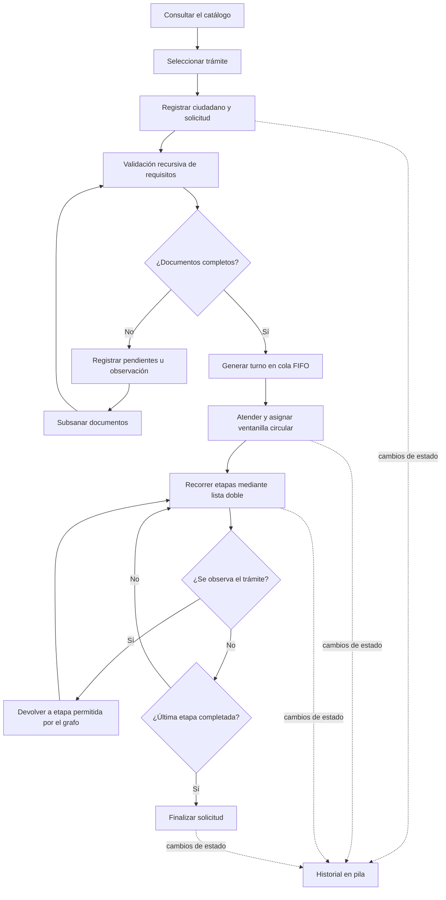
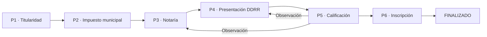

<h1 align="center">🏛️ TRAMITEAGIL DDRR</h1>
<p align="center"><strong>SISTEMA DE GESTIÓN DE TRÁMITES Y TURNOS</strong><br>
<strong>DERECHOS REALES — LA PAZ, BOLIVIA</strong></p>
<p align="center"><strong>PROYECTO FINAL INTEGRADOR | ESTRUCTURA DE DATOS</strong><br>
Universidad Privada Domingo Savio — Sede La Paz</p>

---

| **DATOS DE LA PRESENTACIÓN** | **INFORMACIÓN DEL ESTUDIANTE** |
|:---|:---|
| **Estudiante** | Asaf Luis Carlos Roldan Machicado |
| **Carrera** | Ingenieria En Sistemas |
| **Asignatura** | Estructura de Datos |
| **Semestre** | Quinto semestre |
| **Docente** | Msc. Lic. Andrés Grover Albino Chambi |
| **Sigla** | SIS-0130 |
| **Lugar y fecha** | La Paz, Bolivia — 28 de octubre de 2026 |
| **Repositorio GitHub** | https://github.com/asafnerdrm-coder/Proyecto_Final_Integrador_4.git |
| **Video demostrativo** | [PEGAR ENLACE AL VIDEO] |

**Tecnologías:** `C#` · `.NET 8` · `Consola de Windows` · `Git/GitHub`  
**ODS vinculado:** `ODS 16 — Paz, justicia e instituciones sólidas`

> **Aviso:** TramiteAgil DDRR es una **simulación académica**. No pertenece al Consejo de la Magistratura, no realiza registros oficiales y no reemplaza la información, validación jurídica ni los sistemas de Derechos Reales.

---

## 📑 Índice

1. [Presentación del proyecto](#1-presentación-del-proyecto)
2. [Contexto de los trámites en Bolivia](#2-contexto-de-los-trámites-en-bolivia)
3. [Problemática y demoras en Derechos Reales](#3-problemática-y-demoras-en-derechos-reales)
4. [Justificación](#4-justificación)
5. [Objetivos](#5-objetivos)
6. [Alcance y limitaciones](#6-alcance-y-limitaciones)
7. [Trámites modelados](#7-trámites-modelados)
8. [Funcionamiento del sistema](#8-funcionamiento-del-sistema)
9. [Estructuras de datos implementadas](#9-estructuras-de-datos-implementadas)
10. [Grafos y algoritmos de recorrido](#10-grafos-y-algoritmos-de-recorrido)
11. [Arquitectura y organización del código](#11-arquitectura-y-organización-del-código)
12. [Instalación y ejecución](#12-instalación-y-ejecución)
13. [Pruebas y validación](#13-pruebas-y-validación)
14. [Complejidad de las operaciones](#14-complejidad-de-las-operaciones)
15. [Aporte social y valor emprendedor](#15-aporte-social-y-valor-emprendedor)
16. [Resultados esperados y mejoras futuras](#16-resultados-esperados-y-mejoras-futuras)
17. [Conclusiones](#17-conclusiones)
18. [Referencias y fuentes consultadas](#18-referencias-y-fuentes-consultadas)
19. [Autoría y créditos](#19-autoría-y-créditos)

---

## 1. Presentación del proyecto

**TramiteAgil DDRR** es una aplicación de consola desarrollada en **C# con .NET 8** para simular el registro, la atención y el seguimiento de trámites relacionados con bienes inmuebles. Está inspirada en los procesos del Registro Público de Derechos Reales de La Paz, Bolivia.

El sistema organiza los datos de las solicitudes, comprueba requisitos documentales, genera turnos, distribuye la atención entre ventanillas, permite recorrer etapas registrales y registra el historial de estados. También representa las rutas posibles de cada trámite mediante **grafos dirigidos**, incluidos los retornos por observaciones.

Su finalidad principal es **aplicar los contenidos de la asignatura Estructura de Datos a una situación cercana a la realidad**, evidenciando el comportamiento de arreglos, memoria dinámica, recursividad, pila, cola, lista doblemente enlazada, lista circular y grafo.

**Público de referencia:** estudiantes, docentes y personas interesadas en comprender cómo un sistema informático puede modelar procedimientos documentales complejos.

## 2. Contexto de los trámites en Bolivia

En Bolivia, el registro de derechos sobre inmuebles es una actividad de importancia jurídica y social: permite dar publicidad registral a actos y derechos relacionados con bienes inmuebles. El servicio de **Derechos Reales (DDRR)** forma parte del ámbito del **Órgano Judicial**, bajo el Consejo de la Magistratura; **no es una dependencia de la Alcaldía de La Paz**.

Los trámites relacionados con inmuebles pueden involucrar diferentes instituciones. Por ejemplo, una compraventa puede requerir actuaciones **municipales** (aspectos catastrales y tributarios), **notariales** (formalización documental) y finalmente **registrales** (presentación y calificación en Derechos Reales). Se trata de intervenciones distintas que el proyecto diferencia en sus etapas simuladas. La guía del Gobierno Autónomo Municipal de La Paz sobre registro de transferencias explica, entre otros aspectos, que el pago de un impuesto municipal no acredita por sí solo el derecho propietario.[^gam-lp]

El portal oficial del Consejo de la Magistratura distingue entre **inscripciones rápidas**, **trámites de inscripción en gabinete** y **servicios de ventanilla en línea**. Entre los servicios publicados se encuentran correcciones de datos, compraventa, inscripción de gravámenes, matriculación, certificados y Folio Real actualizado.[^catalogo-oficial]

### 2.1 Conceptos importantes

| Concepto | Explicación en el contexto del proyecto |
|---|---|
| **Derechos Reales** | Servicio registral que inscribe y publicita actos y derechos vinculados con inmuebles. |
| **Folio Real** | Registro asociado a una matrícula que contiene información registral del inmueble, como titularidad y gravámenes. |
| **Matrícula** | Identificador registral del inmueble. |
| **Inscripción** | Asiento o registro de un acto o derecho conforme a los requisitos que correspondan. |
| **Calificación registral** | Revisión registral previa a efectuar la inscripción solicitada. |
| **Observación** | Incidencia que requiere aclarar o subsanar documentación o datos. |
| **Subsanación** | Presentación de información o documentos para atender una observación. |
| **Turno** | Identificador que determina el orden de atención en la simulación. |

### 2.2 ¿Por qué los trámites pueden tener varios pasos?

Una solicitud no siempre se resuelve en una sola ventanilla. Según su naturaleza, puede exigir revisión de identidad, documentos notariales, datos técnicos, antecedentes registrales o comprobantes administrativos. Si existe una inconsistencia, es posible que el interesado deba corregirla antes de continuar. **Estos son escenarios generales de análisis, no una descripción obligatoria de todos los expedientes reales**.

## 3. Problemática y demoras en Derechos Reales

La motivación del proyecto es la necesidad de contar con procesos **ordenados, comprensibles y trazables**. Cuando una persona desconoce los requisitos, el paso actual o el motivo de una observación, puede enfrentar visitas adicionales y pérdida de tiempo. Si además existen turnos numerosos o controles documentales sucesivos, la experiencia se vuelve más complicada.

### 3.1 Evidencia contextual documentada

- Una nota periodística publicada por **El Diario el 28 de abril de 2025** recogió declaraciones sobre la operación de Derechos Reales en La Paz, con una concurrencia estimada de **700 a 800 trámites diarios**, así como medidas para habilitar más ventanillas y evitar largas filas. **Es una cifra declarada en esa nota, no una medición propia del proyecto ni un promedio oficial actualizado**.[^eldiario]
- **Correo del Sur, el 12 de febrero de 2025**, informó que el Consejo de la Magistratura había recibido denuncias en La Paz por errores en la inscripción de datos y **demoras en la entrega de certificaciones**, remitidas a instancias de investigación. La existencia de denuncias no permite cuantificar cuánto demora, en promedio, cada trámite.[^correodelsur]
- La **Agencia Boliviana de Información**, el **10 de julio de 2026**, reportó una inspección de oficinas de Derechos Reales en La Paz y El Alto en la que se evaluaron, entre otros asuntos, tiempos de respuesta y manejo de archivos. Esto aporta contexto sobre la importancia del control y seguimiento de los servicios, pero no demuestra por sí solo retrasos generalizados.[^abi2026]

### 3.2 ¿Cuánto demora un trámite?

**No existe un plazo único aplicable a todos los trámites registrales.** El tiempo depende del servicio, su base normativa, la documentación presentada, la existencia de observaciones y las condiciones de atención. Para orientar la lectura se distinguen los siguientes casos:

| Servicio o procedimiento | Referencia publicada | Interpretación correcta |
|---|---|---|
| **Folio Real actualizado** | El manual del Consejo de la Magistratura indica atención **inmediata** para el servicio descrito.[^folio] | Es un plazo publicado para ese servicio, no una garantía universal en cualquier circunstancia. |
| **Certificado de no propiedad a nivel nacional** | La ficha del Consejo de la Magistratura señala **3 días hábiles**.[^cnp] | La versión académica emplea un certificado simplificado; no corresponde extrapolar el plazo a todas sus variantes. |
| **Corrección de datos bajo el procedimiento de la Ley 247** | El art. 9 del **DS 4273** dispone la emisión del Folio Real corregido en un máximo de **3 días hábiles**, bajo los supuestos regulados.[^ds4273] | No significa que cualquier corrección de cualquier expediente de DDRR tenga siempre ese plazo. |

> **Diferencia fundamental:** un **plazo normativo o publicado** no es lo mismo que una **medición del tiempo real de espera**. Este repositorio no cuenta con una base de datos oficial de expedientes ni pretende calcular la demora promedio de DDRR en La Paz. Los plazos incluidos en el catálogo del programa son **referenciales o simulados**, y no deben interpretarse como compromisos de la institución.

### 3.3 Problemas que aborda el prototipo

| Situación identificada | Respuesta del prototipo |
|---|---|
| Confusión sobre los requisitos | Catálogo y validación recursiva de documentos. |
| Desorden en la asignación de turnos | Cola FIFO para atender según el orden de llegada. |
| Asignación repetitiva de ventanillas | Lista circular para rotar tres ventanillas simuladas. |
| Dificultad para conocer el estado | Seguimiento de la solicitud y del paso actual. |
| Devoluciones por observaciones | Registro y subsanación de requisitos; transiciones representadas en un grafo. |
| Falta de trazabilidad en la demostración | Pila de historial de cambios de estado. |

## 4. Justificación

**Justificación social.** El orden y la transparencia en los procedimientos documentales favorecen una mejor comprensión del servicio por parte de las personas. Una representación clara de los requisitos y las etapas puede ser útil para diseñar futuras herramientas de orientación ciudadana.

**Justificación académica.** Los trámites de Derechos Reales ofrecen un escenario concreto para comparar estructuras de datos: la cola responde al orden de llegada, la pila al historial, las listas a los pasos y ventanillas, y el grafo a los caminos y decisiones.

**Justificación tecnológica.** Una aplicación de consola permite observar cómo operan los algoritmos sin requerir una interfaz gráfica ni una base de datos. Esto facilita explicar las clases, los nodos, sus referencias y los costos de las operaciones.

**Justificación emprendedora.** El sistema sirve como prueba de concepto para soluciones de orientación, turnos y seguimiento. **No se afirma que reduzca tiempos reales**, porque no se han efectuado mediciones de campo ni una implementación institucional.

## 5. Objetivos

### 5.1 Objetivo general

Desarrollar una aplicación de consola en C# que simule la gestión de turnos, la validación de requisitos, el flujo de etapas y el seguimiento de solicitudes de trámites de Derechos Reales de La Paz, mediante el uso de estructuras de datos y algoritmos de recorrido.

### 5.2 Objetivos específicos

1. Definir un **catálogo de trámites** y sus requisitos mediante arreglos.
2. Registrar dinámicamente ciudadanos, solicitudes y turnos durante la ejecución.
3. Comprobar requisitos simples y compuestos mediante **recursividad**.
4. Atender los turnos pendientes de acuerdo con una **cola FIFO**.
5. Distribuir la atención en tres ventanillas mediante una **lista circular**.
6. Modelar las etapas de cada solicitud con una **lista doblemente enlazada**.
7. Registrar cambios de estado en una **pila LIFO**.
8. Construir **grafos dirigidos** que representen avances, observaciones y posibles retornos, con BFS, DFS y detección de ciclos.
9. Verificar los escenarios principales mediante pruebas automáticas y manuales.

## 6. Alcance y limitaciones

### 6.1 Qué incluye esta versión

- Tres tipos de trámites académicos con diferentes cantidades de pasos.
- Registro de solicitudes con información ingresada por teclado.
- Comprobación de documentos presentados y pendientes.
- Subsanación posterior de requisitos faltantes (opción 11).
- Generación de turnos cuando se completan los requisitos de la simulación.
- Atención FIFO y rotación de tres ventanillas.
- Seguimiento de la etapa actual e historial de eventos.
- Registro de observaciones y devoluciones en los pasos permitidos por el flujo.
- Representación de grafos, recorridos BFS/DFS y detección de ciclos.
- Modos de demostración y pruebas desde CMD.

### 6.2 Qué NO incluye

- Conexión con sistemas institucionales, padrones, archivos catastrales ni bases registrales reales.
- Emisión de certificados o Folios Reales oficiales.
- Firma digital, verificación jurídica, autenticación institucional ni pagos reales.
- Almacenamiento permanente: **al cerrar la aplicación se pierden los registros creados en memoria**.
- Estadísticas reales de tiempo de atención o garantía de reducción de demoras.
- Un árbol binario de búsqueda independiente: existen **requisitos jerárquicos recorridos recursivamente**, que no deben confundirse con una implementación completa de un árbol de búsqueda.

## 7. Trámites modelados

Los ejemplos se basan en servicios registrales existentes, pero su **secuencia y requisitos se simplificaron** para permitir la demostración de las estructuras de datos.

| Código | Trámite del catálogo | Cantidad de pasos | Finalidad simulada |
|:---:|---|:---:|---|
| `CNP` | Certificado de No Propiedad Urbana | 3 | Solicitar, revisar antecedentes y emitir una certificación simulada. |
| `COR` | Corrección de datos en el Folio Real | 4 | Presentar respaldos, revisar, subinscribir la corrección y emitir un folio corregido simulado. |
| `TRA` | Transferencia de inmueble e inscripción de Folio Real | 6 | Mostrar un recorrido integral que incluye gestiones externas y etapa registral. |

**Aclaración:** El catálogo usa la denominación académica «Certificado de No Propiedad Urbana». No debe confundirse automáticamente con los certificados oficiales de ámbito nacional o departamental, que tienen fichas y requisitos propios.

### 7.1 Trámite CNP — Certificado de no propiedad

**Pasos:** presentación de solicitud → búsqueda/verificación registral → emisión y entrega.

El caso representa una consulta documental que permite ilustrar un flujo corto. El catálogo solicita identificación, formulario y comprobante simulado. Para trámites reales, deben consultarse los requisitos oficiales y la modalidad correspondiente.[^cnp]

### 7.2 Trámite COR — Corrección de datos del Folio Real

**Pasos:** presentación de requisitos → revisión documental → subinscripción de escritura unilateral → emisión del Folio Real corregido.

El ejemplo incorpora un **requisito compuesto**: la escritura pública unilateral de aclaración se modela mediante la minuta y su protocolización. Esta estructura permite demostrar la recursividad. El caso toma como referencia el procedimiento regulado por el DS 4273, sin afirmar que todos los casos se solucionen con los mismos documentos.[^ds4273]

### 7.3 Trámite TRA — Transferencia e inscripción

**Pasos:** verificar titularidad → gestión municipal del impuesto → protocolización notarial → presentación en DDRR → calificación registral → inscripción y entrega.

Este caso es el más extenso y sirve para mostrar dependencias entre etapas. **Las actividades municipales y notariales se presentan como gestiones externas**, no como funciones realizadas por funcionarios de DDRR. La documentación exacta depende del tipo de transferencia y de la normativa aplicable.[^gam-lp][^inscripcion]

## 8. Funcionamiento del sistema

### 8.1 Flujo general de una solicitud



El diagrama es una **representación de alto nivel**; las opciones concretas dependen del estado de la solicitud y de las transiciones implementadas para cada trámite.

### 8.2 Estados de la solicitud

`Registrada → EnEspera → EnAtencion → EnProceso → Finalizada`

Según el caso, puede existir también el estado `Observada`, con un proceso de subsanación y retorno. Los cambios se reflejan en el historial correspondiente.

### 8.3 Menú de consola

```text
--------------------------- MENÚ ---------------------------
 1. Ver catálogo de trámites (arreglo)
 2. Nueva solicitud + validar requisitos + generar turno
 3. Atender siguiente turno (cola + ventanillas circulares)
 4. Avanzar un paso del trámite (lista doble)
 5. Observar trámite / retroceder un paso (lista doble)
 6. Seguimiento de una solicitud
 7. Historial de estados (pila) y deshacer
 8. Ver grafo de flujo de un trámite
 9. Ver cola de turnos y ventanillas
10. Demostración automática completa
11. Presentar documentos pendientes / subsanar
 0. Salir
------------------------------------------------------------
```

## 9. Estructuras de datos implementadas

| Estructura | Implementación y ubicación | Función dentro del proyecto |
|---|---|---|
| **Arreglo** | `TipoTramite[]`, arreglos de `Requisito[]` y `Paso[]` | Guardar catálogo y elementos de cada trámite. |
| **Memoria dinámica** | Creación de `Solicitud`, `Turno`, `Nodo<T>` | Instanciar elementos según las acciones del usuario. |
| **Recursividad** | `ValidadorRequisitos` | Validar requisitos y subrequisitos de forma jerárquica. |
| **Pila** | `Estructuras/Pila.cs` | Historial LIFO; apoyar algoritmos del grafo. |
| **Cola** | `Estructuras/Cola.cs` | Atender turnos FIFO; apoyar BFS. |
| **Lista doble** | `Estructuras/ListaDoble.cs` | Moverse entre etapas anteriores y siguientes. |
| **Lista circular** | `Estructuras/ListaCircular.cs` | Rotar las ventanillas 1 → 2 → 3 → 1. |
| **Grafo dirigido** | `Estructuras/Grafo.cs` | Modelar caminos, decisiones y observaciones. |

### 9.1 Pila: principio LIFO

**Último en entrar, primero en salir.** Cada solicitud registra cambios de estado en una pila. Esto facilita consultar eventos recientes y, en los casos admitidos por el programa, deshacer una transición sin deshacer la atención que ya ocurrió.

### 9.2 Cola: principio FIFO

**Primero en entrar, primero en salir.** Los turnos ingresan por el final y se atienden desde el frente. La implementación dispone de referencias al inicio y al final para mantener operaciones de encolado y desencolado de costo constante.

### 9.3 Lista doblemente enlazada

Cada nodo contiene referencias al **anterior** y al **siguiente**. El cursor representa la etapa en la que se encuentra la solicitud. A diferencia de una lista simple, permite navegar en ambos sentidos.

### 9.4 Lista circular

El último nodo vuelve a conectarse con el primero. Se utiliza para rotar tres ventanillas simuladas. Esta distribución **no mide la carga de trabajo real** ni predice la disponibilidad de cada puesto.

### 9.5 Recursividad y jerarquía de requisitos

Un requisito puede ser simple (un documento) o compuesto (varios subdocumentos). La validación comprueba recursivamente cada elemento y se detiene cuando llega a una hoja o se agotan los requisitos. La jerarquía funciona como un **árbol conceptual de requisitos**, aunque el trabajo no implementa un árbol binario de búsqueda como estructura independiente.

## 10. Grafos y algoritmos de recorrido

En el sistema, un **vértice** representa una etapa registral y una **arista dirigida** representa una transición permitida. Las aristas pueden significar **continuar** o **devolver por observación**.

El grafo se almacena mediante una **lista de adyacencia construida con enlaces**. Esto permite recorrer los destinos asociados a cada vértice.



*Ejemplo tomado del flujo académico TRA. El grafo incluye un ciclo porque algunas observaciones pueden devolver la solicitud a etapas anteriores.*

| Algoritmo | Funcionamiento | Aplicación en el sistema |
|---|---|---|
| **BFS (búsqueda en anchura)** | Recorre por niveles usando una cola. | Encontrar una ruta con menos transiciones entre nodos. |
| **DFS (búsqueda en profundidad)** | Explora un camino antes de retroceder, con pila. | Obtener un recorrido de los vértices del grafo. |
| **Detección de ciclos** | DFS recursivo con estados de visita. | Identificar retornos por observaciones. |

**Importante:** `RutaMasCorta` busca el menor **número de aristas**, no el menor tiempo de atención ni la ruta más rápida en días. En esta versión no se calculan tiempos reales ni se optimizan recursos institucionales.

## 11. Arquitectura y organización del código

```text
TramiteAgil/
├── TramiteAgil.csproj
├── README.md
├── Estructuras/
│   ├── Nodo.cs
│   ├── Pila.cs
│   ├── Cola.cs
│   ├── ListaDoble.cs
│   ├── ListaCircular.cs
│   └── Grafo.cs
├── Modelos/
│   └── Modelos.cs
├── Servicios/
│   ├── CatalogoDerechosReales.cs
│   ├── ValidadorRequisitos.cs
│   ├── ConstructorGrafo.cs
│   └── SistemaTramites.cs
├── Interfaz/
│   ├── Program.cs
│   ├── Menu.cs
│   ├── Vista.cs
│   ├── Pruebas.cs
│   └── Demo.cs
└── docs/
    ├── INFORME_TECNICO.md
    └── GUION_VIDEO.md
```

**Capas principales:**

- **Estructuras:** implementaciones de nodos y algoritmos.
- **Modelos:** clases que representan ciudadanos, trámites, requisitos, pasos, solicitudes y turnos.
- **Servicios:** reglas de negocio, validación documental y construcción de grafos.
- **Interfaz:** comunicación con el usuario mediante menú, salidas de consola, demostraciones y pruebas.

> La estructura corresponde al proyecto de código revisado. Si cambias los nombres o mueves archivos antes de subirlos a GitHub, actualiza este árbol.

## 12. Instalación y ejecución

### Requisitos previos

- Windows con CMD o PowerShell; también puede ejecutarse en otras plataformas con .NET compatible.
- **SDK de .NET 8** instalado (el proyecto usa `net8.0`).
- Visual Studio o Visual Studio Code, opcionales para editar.
- Git, si se desea publicar mediante terminal.

Verificar la instalación:

```cmd
dotnet --version
```

### Ejecutar desde CMD

1. Descarga o clona el repositorio.
2. Abre la carpeta que contiene **`TramiteAgil.csproj`**.
3. Haz clic en la barra de dirección del Explorador de Windows, escribe `cmd` y presiona Enter.
4. Ejecuta los siguientes comandos:

```cmd
dotnet build
dotnet run
```

> Si usas `cd` para cambiar de carpeta y la ruta tiene espacios, usa comillas, por ejemplo: `cd /d "C:\RUTA\A\TramiteAgil"`. No basta con escribir la ruta sola en CMD.

### Modos adicionales

```cmd
:: Pruebas automáticas
dotnet run -- --test

:: Demostración automática
dotnet run -- --demo
```

**Nota de validación:** estos comandos están definidos en el código fuente. Al preparar este README no se ejecutó una compilación con el SDK de .NET en el entorno de documentación, por lo que el resultado de las pruebas debe registrarse después de verificarlas en tu computadora.

## 13. Pruebas y validación

### 13.1 Escenarios de prueba manual

| Caso | Procedimiento | Resultado esperado |
|---|---|---|
| **P01** | Registrar una solicitud sin todos los documentos. | Solicitud registrada con pendientes, sin turno. |
| **P02** | Presentar solo parte de los documentos faltantes. | Persisten los requisitos pendientes durante la misma ejecución. |
| **P03** | Completar los documentos usando la opción 11. | Se completa la validación y se genera el turno según las reglas del sistema. |
| **P04** | Generar varios turnos y atenderlos. | Se respeta el orden de llegada FIFO. |
| **P05** | Atender cuatro solicitudes. | Las ventanillas rotan 1 → 2 → 3 → 1. |
| **P06** | Consultar el historial. | Los eventos aparecen del más reciente al más antiguo. |
| **P07** | Avanzar y observar una etapa de revisión. | Solo se permite el retorno configurado en el flujo. |
| **P08** | Mostrar un grafo. | Se visualizan pasos, aristas y recorridos; se identifican ciclos cuando corresponda. |
| **P09** | Completar un trámite. | La solicitud alcanza el estado final permitido. |
| **P10** | Cerrar y reiniciar la aplicación. | Los datos anteriores no se conservan: limitación conocida de la versión. |

### 13.2 Pruebas automáticas

La clase `Interfaz/Pruebas.cs` contiene comprobaciones de las estructuras y de los flujos implementados. Se inicia mediante:

```cmd
dotnet run -- --test
```

**Estado de evidencia:** [PENDIENTE DE COMPLETAR DESPUÉS DE EJECUTAR EN TU EQUIPO]

| Evidencia | Registrar después de la ejecución |
|---|---|
| Resultado de `dotnet build` | [CORRECTO / ERROR] |
| Resultado de `dotnet run -- --test` | [PRUEBAS APROBADAS / DETALLAR FALLAS] |
| Fecha de prueba | [DD/MM/AAAA] |
| Entorno | [VERSIÓN DE WINDOWS / SDK .NET] |

**Capturas sugeridas para GitHub:** `docs/capturas/menu.png`, `docs/capturas/registro.png`, `docs/capturas/grafo.png` y `docs/capturas/pruebas.png`. Inserta las imágenes en este README **solo después de crear esos archivos**, usando rutas relativas válidas.

## 14. Complejidad de las operaciones

| Operación | Complejidad teórica | Observación |
|---|:---:|---|
| `Push` / `Pop` en pila | `O(1)` | Acceso a la cima. |
| Encolar / desencolar | `O(1)` | Referencias al frente y al final. |
| Avanzar / retroceder cursor doble | `O(1)` | Desde un nodo ya localizado. |
| Rotación de ventanilla | `O(1)` | Siguiente referencia circular. |
| BFS / DFS | `O(V + E)` | `V`: vértices; `E`: aristas. |
| Validar requisitos recursivamente | `O(R)` | `R`: total de requisitos y subrequisitos recorridos. |
| Buscar una solicitud por ID | `O(S)` | Búsqueda lineal en `S` solicitudes de esta versión. |

Estos valores expresan el análisis de los algoritmos; **no representan métricas medidas de rendimiento** en el sistema de Derechos Reales.

## 15. Aporte social y valor emprendedor

El proyecto se relaciona con el **Objetivo de Desarrollo Sostenible 16**, especialmente con el interés de promover instituciones eficaces, responsables y transparentes.

Su aporte potencial se expresa en tres ideas:

1. **Claridad:** mostrar requisitos, documentos pendientes y etapas de atención.
2. **Orden:** representar una fila y distribuir turnos de manera comprensible.
3. **Trazabilidad:** conservar, durante la ejecución, un historial de los cambios en cada solicitud.

Como propuesta de evolución emprendedora, podría desarrollarse un sistema web o de escritorio con almacenamiento seguro, autenticación, control de permisos, accesibilidad y estadísticas. Cualquier implementación en oficinas públicas requeriría autorización institucional, revisión de seguridad, adecuación normativa, protección de datos y pruebas piloto.

## 16. Resultados esperados y mejoras futuras

### Resultados que se busca demostrar

- Uso articulado de las estructuras de datos solicitadas en la asignatura.
- Una simulación de trámites con pasos, documentos y estados diferenciados.
- Recorridos de grafos y gestión de retornos por observaciones.
- Atención de turnos con estructuras implementadas en código.
- Una base explicable y ampliable para futuros desarrollos.

### Mejoras propuestas

| Prioridad | Mejora | Beneficio previsto |
|:---:|---|---|
| Alta | Guardado en JSON o base de datos | Conservar solicitudes al cerrar la aplicación. |
| Alta | Más pruebas para los nuevos casos de subsanación | Evitar regresiones y verificar escenarios completos. |
| Alta | Validaciones y restricciones adicionales | Reducir estados inconsistentes en la simulación. |
| Media | Roles de operador y administrador | Separar permisos y operaciones. |
| Media | Consulta por número de solicitud | Facilitar el seguimiento. |
| Media | Reportes de tiempos simulados | Analizar el comportamiento del prototipo sin confundirlo con estadísticas oficiales. |
| Futura | Interfaz gráfica o aplicación web | Mejorar la experiencia de uso. |

## 17. Conclusiones

1. **Aplicación de conocimientos.** TramiteAgil DDRR demuestra cómo los conceptos de Estructura de Datos pueden aplicarse a un problema de organización documental, turnos y seguimiento.
2. **Elección de estructuras.** Cada estructura responde a una necesidad distinta: la cola organiza la atención; la pila conserva el historial; la lista doble describe las etapas; la lista circular rota las ventanillas; y el grafo representa decisiones y posibles devoluciones.
3. **Importancia de los grafos.** Los procesos registrales no son necesariamente lineales. La presencia de observaciones puede generar retornos y ciclos, por lo que un grafo dirigido permite describirlos con mayor precisión que una secuencia única de pasos.
4. **Comprensión del contexto boliviano.** El trabajo diferencia correctamente las funciones de Derechos Reales de las gestiones municipales y notariales. También reconoce que los requisitos y plazos dependen del servicio específico y que las demoras reales no pueden inferirse a partir de una simulación.
5. **Alcance del prototipo.** El proyecto constituye una herramienta didáctica y una prueba de concepto, no una plataforma institucional ni una solución cuya eficiencia operativa haya sido validada en campo.
6. **Proyección futura.** El modelo puede ampliarse con persistencia, seguridad, reportes, interfaces de usuario y pruebas de desempeño para explorar su aplicación en sistemas de atención ciudadana.

En síntesis, **TramiteAgil DDRR integra teoría, programación y contexto social** en un proyecto de consola que hace visibles las decisiones de diseño y el comportamiento de las principales estructuras de datos estudiadas.

## 18. Referencias y fuentes consultadas

Las fuentes siguientes respaldan el **contexto boliviano y los procedimientos mencionados**. No sustituyen una consulta oficial vigente para realizar un trámite real.

**Fuentes institucionales y normativas**

1. [Consejo de la Magistratura — Información de Trámites en Derechos Reales](https://tramitesddrr.organojudicial.gob.bo/).
2. [Consejo de la Magistratura — Folio Real actualizado](https://cm.organojudicial.gob.bo/consejo/requisitosddrr/42_-folio-real-actualizado.html).
3. [Consejo de la Magistratura — Certificado de No Propiedad a Nivel Nacional](https://cm.organojudicial.gob.bo/consejo/requisitosddrr/43_-certificado-de-no-propieda.html).
4. [Decreto Supremo N.º 4273 de 2020 — Procedimiento específico de corrección de datos, art. 9](https://www.prorevi.gob.bo/wp-content/uploads/2020/07/DecretoSupremo4273.pdf).
5. [Gobierno Autónomo Municipal de La Paz — Registro de transferencias onerosas](https://www.gob.bo/tramites/registro-de-transferencias-onerosas-de-bienes-inmuebles).
6. [Tribunal Departamental de Justicia de La Paz — Requisitos de inscripción de propiedad](https://lapaz.organojudicial.gob.bo/Documentos/tramites%2020220712135842.pdf).

**Fuentes de contexto y reportes de atención**

7. [El Diario (28/04/2025) — El Folio Real habilita al ciudadano para ejercer su derecho propietario](https://www.eldiario.net/portal/2025/04/28/el-folio-real-habilita-al-ciudadano-para-ejercer-su-derecho-propietario/).
8. [Correo del Sur (12/02/2025) — La Paz: Consejo despide a funcionaria de DD.RR.](https://correodelsur.com/seguridad/20250212/la-paz-consejo-despide-a-funcionaria-de-dd-rr.html).
9. [ABI (10/07/2026) — Inspección en dependencias judiciales de La Paz](https://abi.bo/operativo-de-la-magistratura-permitio-inspeccionar-el-tribunal-de-justicia-de-la-paz-y-recibir-denuncias/).

*Fecha de consulta de las fuentes en línea: octubre de 2026.*

[^catalogo-oficial]: Consejo de la Magistratura, *Información de Trámites en Derechos Reales*. https://tramitesddrr.organojudicial.gob.bo/ (consulta: octubre de 2026).
[^folio]: Consejo de la Magistratura, *Folio Real actualizado: requisitos y plazo publicado*. https://cm.organojudicial.gob.bo/consejo/requisitosddrr/42_-folio-real-actualizado.html (consulta: octubre de 2026).
[^cnp]: Consejo de la Magistratura, *Certificado de No Propiedad a Nivel Nacional: requisitos y plazo publicado*. https://cm.organojudicial.gob.bo/consejo/requisitosddrr/43_-certificado-de-no-propieda.html (consulta: octubre de 2026).
[^ds4273]: Estado Plurinacional de Bolivia, *Decreto Supremo N.º 4273, de 26 de junio de 2020*, art. 9 (procedimiento específico de corrección). https://www.prorevi.gob.bo/wp-content/uploads/2020/07/DecretoSupremo4273.pdf (consulta: octubre de 2026).
[^gam-lp]: Gobierno Autónomo Municipal de La Paz, *Registro de transferencias onerosas de bienes inmuebles*, Portal de Trámites del Estado. https://www.gob.bo/tramites/registro-de-transferencias-onerosas-de-bienes-inmuebles (consulta: octubre de 2026).
[^inscripcion]: Tribunal Departamental de Justicia de La Paz, *Requisitos Derechos Reales: inscripción de propiedad*, documento institucional. https://lapaz.organojudicial.gob.bo/Documentos/tramites%2020220712135842.pdf (consulta: octubre de 2026).
[^eldiario]: *El Diario*, 28 de abril de 2025, “El Folio Real habilita al ciudadano para ejercer su derecho propietario”. https://www.eldiario.net/portal/2025/04/28/el-folio-real-habilita-al-ciudadano-para-ejercer-su-derecho-propietario/
[^correodelsur]: *Correo del Sur*, 12 de febrero de 2025, “La Paz: Consejo despide a funcionaria de DD.RR.” https://correodelsur.com/seguridad/20250212/la-paz-consejo-despide-a-funcionaria-de-dd-rr.html
[^abi2026]: Agencia Boliviana de Información, 10 de julio de 2026, “Operativo de la Magistratura permitió inspeccionar el Tribunal de Justicia de La Paz y recibir denuncias”. https://abi.bo/operativo-de-la-magistratura-permitio-inspeccionar-el-tribunal-de-justicia-de-la-paz-y-recibir-denuncias/

**Documentación del proyecto utilizada como base:** `INFORME_TECNICO.md` proporcionado para la redacción del presente README y los archivos fuente de `TramiteAgil_DDRR_Mejorado.zip`. La descripción funcional se ajustó a ese código; los contextos jurídicos y periodísticos se distinguen de la simulación.

## 19. Autoría y créditos

**Desarrollado por:** [NOMBRE COMPLETO DEL ESTUDIANTE]  
**Carrera:** [CARRERA]  
**Institución:** Universidad Privada Domingo Savio — La Paz  
**Asignatura:** Estructura de Datos  
**Docente:** Msc. Lic. Andrés Albino  
**Gestión:** [GESTIÓN ACADÉMICA]

**Video del proyecto:** [ENLACE PENDIENTE]  
**Repositorio:** [ENLACE PENDIENTE]

---

<p align="center"><strong>TRAMITEAGIL DDRR</strong><br>
<em>Una simulación académica para comprender el valor de las estructuras de datos en la gestión de trámites registrales.</em></p>
